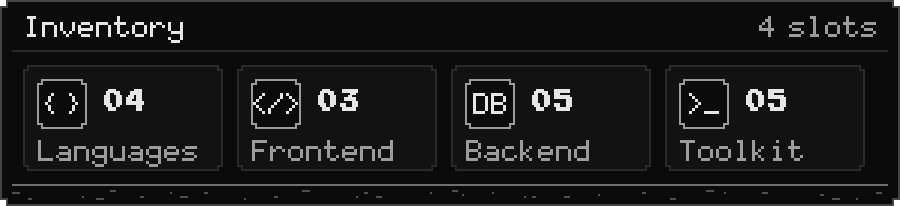

<div align="center">

<!-- HERO: CHROME DINO RUNNER WORLD -->
<picture>
  <source media="(prefers-reduced-motion: reduce)" srcset="assets/static/dino-world.svg">
  
</picture>

<br>

[](https://linkedin.com/in/mohd-junaid-5248a3314)
[](https://twitter.com/mohd_junaid_22)
[](https://github.com/mohd-junaid-05)
[](https://instagram.com/md__junaid_05)
[](mailto:junaid03mo22@gmail.com)

</div>

---

### `01 / PLAYER PROFILE`

> *"Turning ideas into resilient software through modular architectures, AI agents, and spec-driven execution."*

Hey, I'm **Mohd Junaid** — a third-year B.Tech Computer Science student, Full-Stack Developer, and President of **NEXUS Coding Club**.

My engineering focus centers on building reliable web applications and intelligent developer tooling. I spend my time exploring how distributed systems fit together, orchestrating **Agentic Workflows**, and implementing **Spec-Driven Development (SDD)** across the modern JavaScript/TypeScript ecosystem.

- 🔭 **Current Focus:** Full-stack product architecture, multi-agent AI systems, and developer ergonomics.
- 🛠️ **Engineering Mindset:** Spec first, plan modularly, build atomically, evaluate rigorously.
- 🏛️ **Community & Leadership:** Leading NEXUS Coding Club — organizing hands-on hackathons, technical workshops, and student developer initiatives.

---

### `02 / HOW I BUILD : THE ENGINEERING LOOP`

<picture>
  <source media="(prefers-reduced-motion: reduce)" srcset="assets/static/workflow-panel.svg">
  
</picture>

I believe the fastest path to clean, reliable software is structured rigor:

1. **`01 / SPECIFY`** — Clarify the exact problem statement, boundary constraints, and testable acceptance criteria before writing code.
2. **`02 / PLAN`** — Architect data schemas, API contracts, and state flows; decompose large systems into verifiable steps.
3. **`03 / BUILD`** — Implement in small, atomic, readable iterations with tight feedback loops and strong type safety.
4. **`04 / EVALUATE`** — Stress test edge cases, profile performance bottlenecks, and refine user experience.

---

### `03 / INVENTORY & TECH STACK`

<picture>
  
</picture>

<div align="center">

| CATEGORY | EQUIPPED TECHNOLOGIES & TOOLS |
|:---|:---|
| **Core & Languages** | `TypeScript` `JavaScript (ESNext)` `Python` `C` `HTML5` `CSS3` |
| **Frontend & UI** | `React 19` `Next.js 16` `Tailwind CSS` `Vite` `Redux Toolkit` |
| **Backend & APIs** | `Node.js` `Express.js` `RESTful APIs` `JWT Auth` `WebSockets` |
| **Databases** | `MongoDB` `PostgreSQL` `MySQL` `Mongoose` `Prisma` |
| **AI & Agentic Tech** | `Agentic Workflows` `Gemini 2.5 Flash` `Puter AI` `LLM Tooling` `SDD` |
| **DevOps & Tooling** | `Git` `GitHub Actions` `Docker` `VS Code` `Postman` `Figma` |

</div>

---

### `04 / FEATURED QUESTS`

<picture>
  
</picture>

| PROJECT | SUMMARY & HIGHLIGHTS | TECH STACK | REPOSITORY / LINK |
|:---|:---|:---|:---:|
| **Roomify** | Transforms 2D architectural floor plans into photorealistic, top-down 3D room renders using generative visual reasoning. | `React 19` `Gemini 2.5 Flash` `Puter AI` | [Explore](https://github.com/mohd-junaid-05/Roomify) |
| **Ghost AI** | Collaborative system-design workspace that synthesizes natural language architecture prompts into interactive system diagrams. | `Next.js 16` `TypeScript` `AI Agents` | [Explore](https://github.com/mohd-junaid-05/ghost-ai) |
| **Repnex** | Next-generation developer workspace exploring interconnected, spec-driven development orchestrated by AI agents. | `Agentic Engineering` `AI Tooling` `TS` | [Explore](https://github.com/mohd-junaid-05/Repnex) |
| **Inkloom** | Constrained AI branding model pipeline that translates company identity rules into vector logo assets. | `Python` `AI Pipeline` `Automation` | [Explore](https://github.com/mohd-junaid-05/inkloom) |
| **NEXUS Club** | Student developer community providing technical workshops, coding bootcamps, and real-world project mentorship. | `Leadership` `Mentoring` `Community` | [Portal](https://github.com/mohd-junaid-05/nexus-website) |

---

### `05 / GITHUB TELEMETRY & ACTIVITY`

<div align="center">

<!-- ISOMETRIC COMMIT CALENDAR (AUTO-GENERATED BY GITHUB ACTIONS) -->
<picture>
  
</picture>

<br><br>

<!-- GITHUB STATS & LANGUAGES (THEMED TO MONOCHROME PALETTE #0B0B0B / #2A2A2A) -->


<br>


</div>

---

### `06 / NEXT CHECKPOINTS`

- [x] **Nexus Hub:** Built student workshops and campus developer initiatives.
- [x] **AI Systems:** Prototyped agentic AI developer tools (*Roomify*, *Ghost AI*, *Repnex*).
- [ ] **Production Products:** Ship end-to-end, spec-driven SaaS web applications.
- [ ] **Open-Source Tooling:** Contribute to agentic frameworks, developer CLI tools, and libraries.
- [ ] **Technical Writing:** Publish architectural breakdowns on system design and spec-driven AI.

<picture>
  <source media="(prefers-reduced-motion: reduce)" srcset="assets/static/checkpoint-panel.svg">
  
</picture>

---

### `07 / LET'S CONNECT`

```
┌────────────────────────────────────────────────────────────────────────┐
│  STATUS: OPEN FOR COLLABORATION & INTRIGUING AI / FULL-STACK PROJECTS  │
│  BASE: INDIA (IST)  •  ROLE: STUDENT & FULL-STACK SYSTEM BUILDER       │
└────────────────────────────────────────────────────────────────────────┘
```

<div align="center">

[](https://linkedin.com/in/mohd-junaid-5248a3314)
[](https://twitter.com/mohd_junaid_22)
[](mailto:junaid03mo22@gmail.com)

<br>

*Keep building. Keep learning. Keep moving forward.*

</div>
