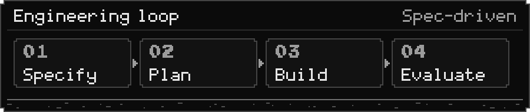
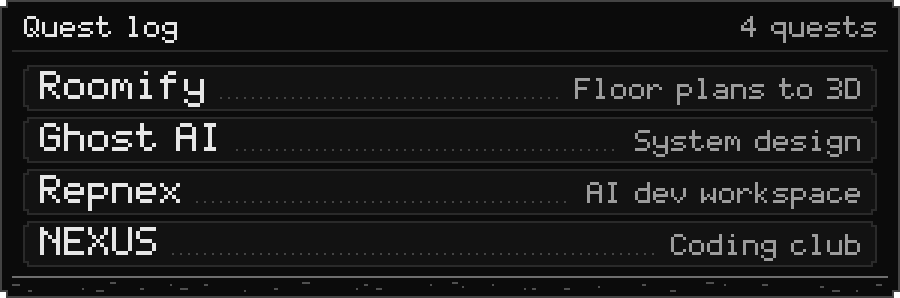

<picture>
  <source media="(prefers-reduced-motion: reduce)" srcset="assets/static/dino-world.svg">
  
</picture>

## `01 / PLAYER PROFILE`

<picture>
  <source media="(prefers-reduced-motion: reduce)" srcset="assets/static/profile-panel.svg">
  
</picture>

## `02 / CURRENT FOCUS`

- **Building:** Full-stack products and AI-powered developer tools.
- **Exploring:** Agentic workflows, AI integrations, and automation.
- **Practising:** Better system design, TypeScript, and spec-driven workflows.
- **Contributing:** Workshops, learning activities, and community projects through NEXUS.

<picture>
  <source media="(prefers-reduced-motion: reduce)" srcset="assets/static/workflow-panel.svg">
  
</picture>

## `03 / HOW I BUILD`

I prefer a clear path from idea to implementation:

1. **Specify** the problem and expected outcome.
2. **Plan** the architecture and break work into steps.
3. **Build** in small, understandable iterations.
4. **Evaluate** the result, test it, and improve it.

This is the mindset I bring to Spec-Driven Development and product building.

## `04 / TECH STACK`

**LANGUAGES**
 

**FRONTEND**
 

**BACKEND & DATABASES**
 

**TOOLS**
 

<picture>
  <source media="(prefers-reduced-motion: reduce)" srcset="assets/static/dino-track.svg">
  
</picture>

## `05 / FEATURED QUESTS`

| PROJECT | WHAT IT DOES | STACK / AREA |
|:--|:--|:--|
| **Roomify** | Turns 2D floor plans into photorealistic, top-down 3D room views. | `React 19` `Gemini 2.5 Flash` `Puter AI` |
| **Ghost AI** | Collaborative system-design workspace that turns plain-English ideas into shared system designs. | `Next.js 16` `TypeScript` `AI Agents` |
| **Repnex** | AI-focused developer workspace exploring a more connected way to build with AI tools. | `Agentic Workflows` `AI` [Repository](https://github.com/mohd-junaid-05/Repnex) |
| **NEXUS Coding Club** | Student developer community focused on learning, workshops, building, and contribution. | `Leadership` `Mentoring` `Community` |

## `06 / GITHUB ACTIVITY`

<picture>
  <source media="(prefers-reduced-motion: reduce)" srcset="assets/static/dino-track.svg">
  
</picture>

## `07 / NEXT CHECKPOINTS`

- [ ] Ship more useful full-stack products.
- [ ] Improve architecture and engineering practices.
- [ ] Build and evaluate more agentic workflows.
- [ ] Make meaningful open-source contributions.

<picture>
  <source media="(prefers-reduced-motion: reduce)" srcset="assets/static/checkpoint-panel.svg">
  
</picture>

## `08 / LET’S CONNECT`

Have an idea, want to collaborate, or just want to talk tech? Feel free to reach out.

*Keep building. Keep learning. Keep moving forward.*

